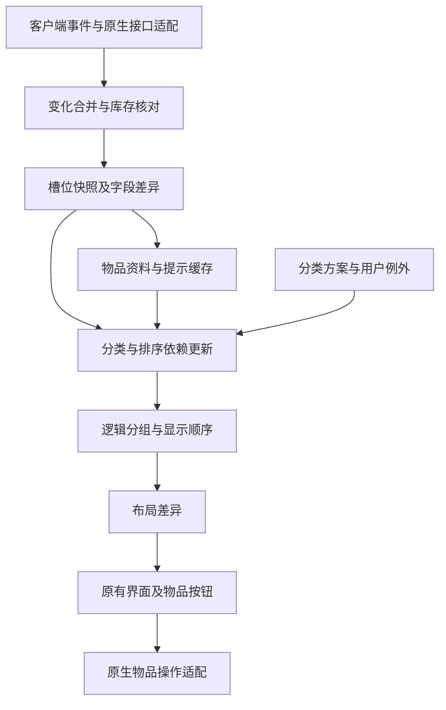

# 乾坤袋重构方案：先完成背包核心

日期：2026-10-11。状态：可实施设计，尚未实施重构或验证收益。核对基础：个人使用版提交 `8f9dfcc`，不是官方原版。本轮不修改插件代码、账号设置、分类配置或 SavedVariables。

配套：[分类与自定义需求模板](Bagshui分类与自定义需求模板.md) · [已有维护记录](../Plugins/Bagshui.md)

**2026-10-11 执行边界更新：用户要求重构为全新的独立插件，不替换原乾坤袋。开发已转入 [QianKunBag](../../Interface/AddOns/QianKunBag/README.md)，首版与实测边界见 [新增插件记录](../Plugins/QianKunBag.md)。下文是此前针对原引擎的设计依据；其中“移除 Catalog/修改原入口/旧内核切换”不在原插件执行。新插件从开始就不实现账户目录与分享，使用独立设置和入口，不自动迁移旧规则；原插件代码、目录、银行及用户配置保持原样。**

## 1. 建议与边界

可行。建议保留当前可用界面、原生物品操作及已有规则的兼容入口，分阶段替换数据、分类、布局和刷新内核。目标是让变化范围决定工作量，让分类结果和自定义需求更容易核对。重构是否成功以功能一致和同条件测量为准，不以文件数量、代码行数减少或架构名称为准。

现有优化已显著降低重复工作，继续收益主要来自细粒度更新、逐帧回调合并、数据生命周期和依赖管理。第一次访问银行仍须核对真实内容；依赖提示的食物、饮料、已学配方等规则也仍需可靠信息，无法通过重构消除所有原生接口成本。不能承诺打开零耗时、内存减半或固定倍数提升。

用户进一步明确：取消“目录”（账户范围库存功能），暂不考虑配置分享，一步一步先完成背包核心。本方案据此替代此前保留目录和扩展分享的设想。

| 范围 | 本阶段处理 |
| --- | --- |
| 当前角色背包 | 重点重构：自动分类、组内排序、分组布局、搜索、编辑、提示、数量/充能/锁定/冷却/徽标、空格、拖动/拆分/真实堆叠、换包和开关入口 |
| 账户范围目录 Catalog | 移除入口及后台运行链路，不只隐藏窗口 |
| 配置分享 Share | 暂不开发或重构，不把卸载它作为首轮任务；保留现用本地配置读取、复制、修改和保存 |
| 银行、当前角色离线银行、钥匙链 | 保持现用实现可用，本阶段不重构；背包对共享代码的改动通过兼容或按库存类型启用 |
| 其他角色账户库存浏览 | 随目录取消，不为它建设新索引或存储 |
| 角色、职业、任务、配方、套装上下文 | 分类需要的部分继续保留，不误当成目录专用数据删除 |

默认沿用现用分类、优先级、布局与操作习惯。不主动清空既存 SavedVariables、账号历史记录或当前配置。首阶段不扩建配置系统；先以中文模板和典型样例方便提交自定义需求。

## 2. 已检查的结构与证据

| 模块 | 当前实现 | 重构切入点 |
| --- | --- | --- |
| Inventory.Cache.lua、ItemInfo.lua | 槽位表混合静态物品信息、动态数量/位置、提示内容、分类和显示状态 | 分离生命周期；槽位差异驱动后续工作 |
| Inventory.Layout.lua | 已跳过无变化完整布局；轻量刷新仍遍历全部可见按钮；分类触发后遍历全部槽位 | 按字段、槽位、分类依赖和分组分别失效 |
| Inventory.Ui.ItemButton.lua | 每个库存按钮安装 OnUpdate；非悬停按钮也进入处理，随后提前返回 | 集中处理悬停提示、修饰键、徽标到期任务 |
| Categories.lua、Rules.lua | 规则已有编译缓存；分类按优先序遍历；显式物品列表逐项比对；规则使用会话环境和受保护调用 | 列表索引、候选规则索引、依赖版本；保留旧表达式回退 |
| Profiles.lua、ObjectManager.lua | 已有布局/外观配置分离及本地编辑能力 | 先沿用，增加简明需求说明与检查样例，不建设分享流程 |
| Catalog.lua | 登录后延迟初始化；更新时重新计算当前角色汇总、合并并排序账号物品列表 | 完整解除运行依赖，停止汇总和索引任务 |
| ObjectList/ObjectManager 等 | 多处编辑器界面已经按需初始化 | 进一步模块拆分前测量，不能重复宣称已有懒初始化是新增收益 |
| Bagshui.xml、PeriodicTable.xml | 主加载链包含编辑器、分享和物品集合数据 | 首轮仅处理目录加载依赖；其他模块及集合数据按核心依赖保留 |
| Hooks.lua、Bank.lua、API.lua | 全局背包入口、BankFrame 替换、规则注册及第三方更新通知 | 稳定兼容层和明确初始化状态，保护按键与原生行为 |

源码抽查统计：Components 63 个 Lua 文件、约 3.86 万行（含注释），Config 10 个 Lua 文件、约 6383 行；这只是代码规模，不代表运行内存或 CPU。图库和字体磁盘大小也不能直接换算为资源占用。共享物品表主要节省重复表及字段、派生状态，不能把 Lua 已可能共享的同值字符串重复计算为全部可节省内存。

最近 v3.2 实测：背包重复打开同步 7.07–9.07 ms，银行重复 7.79–8.70 ms；银行首次完整布局同步 67.91 ms、窗口处理 34.98 ms，整个打开入口最大 125.18 ms，显示前更新最大 43.20 ms，累计提示扫描 153 次/35.91 ms。分类 26.51 ms；复用按钮隐藏归组 144 次/0.36 ms，缩放边框重复应用 0 次。最近这一轮没有捕获背包首次构建。

尚缺：插件可归因的常驻内存、分配速率、控件及子控件数量、可见和隐藏闲置 CPU、账号历史数据规模对资源的影响、同条件冷启动分位数。B 键问题仅在最新登录未复现，根因未知；加入诊断不等于已修复。

## 3. 目录清理与背包目标内核

### 3.0 目录必须完整清理依赖

从 Bagshui.xml 删除 Catalog.lua 之前，先逐条处理调用；单独删加载项会导致缺组件错误。

| 位置 | 检查及处理 |
| --- | --- |
| Bagshui.xml、Catalog.lua | 解除加载/注册依赖，停止登录初始化、事件响应及排队汇总任务 |
| Bindings.xml | 移除目录开关/搜索入口，不重分配 B，不改背包接管语义 |
| Inventory.Ui.lua、Inventory.Menus.lua | 移除工具栏、菜单、修饰键/右键进入目录的动作，当前背包搜索保留 |
| Inventory.Ui.ItemButton.lua、Bagshui.Tooltips.lua | 去掉账户库存等目录提示附加，保留原生提示与背包核心提示 |
| Bagshui.Tooltips.lua 的 FindItemByNameAndTexture 调用 | 此处还用于名称/图标转物品标识，不能直接置空；核对入口，仅保留背包核心所需的本地识别，未知时跳过附加而不破坏原生提示 |
| 钱币提示 | 去掉账户汇总，当前角色金额与钱币操作保持 |
| ObjectManager.lua、Config/Settings.lua、Share.lua | 已核对分享按钮和回调依赖；本阶段保持现状，不为精简直接删除 Share.lua，本地配置编辑及保存保留 |
| CharacterData、任务与套装信息 | 按实际用途处理，分类依赖的角色上下文及暂未重构的银行资料保留 |

验收：目录运行入口不再注册；登录/库存变化不再创建目录任务；可执行的 BsCatalog 调用均清理或有明确替代；搜索、提示、本地编辑、银行无缺组件错误。未加载的历史源码或语言文本可以保留，不能仅用文本搜索“零出现”替代运行检查。Share 不纳入本阶段改造或卸载验收。

收益分开测量：先测现版，再测取消目录后的背包基线，后续内核与这个新基线比较，不能把删功能的收益全部归为同功能架构优化。

各层只通过明确的数据和变化通知沟通。布局不直接重新扫描物品，规则不直接重建界面，纯外观变更不重新分类。兼容层隔离原有 `this/arg1/event` 脚本上下文、GetID 代理和第三方接口；新内核内部使用显式参数，迁移期间不能随意改变旧脚本的全局上下文。背包实例逐步启用新路径，银行和钥匙链保持旧路径，不要求全插件同时切换。

### 3.1 数据与快照

拆为四类记录：

- **物品资料**：名称、类型、品质、堆叠上限等；键至少包含完整物品字符串需要区分的随机后缀、附魔等差异，不仅是物品 ID。
- **槽位状态**：库存/袋号/槽号、物品资料引用、数量、充能、锁定、可读性、槽位版本。相同物品两堆数量不同，不能共用动态状态。
- **上下文资料**：任务、职业/等级、已学配方、套装、外部数据源及各自版本。按实际规则依赖更新。
- **显示状态**：类别/组、显示位置、搜索与编辑状态、按钮绑定版本。与原生物理槽位分开。

提示缓存必须区分基础内容、实例/槽位相关内容和角色相关内容，记录来源及有效版本。已学配方、可用性、充能、绑定状态等不能永久按 ID 共用。无法证明共享安全的数据先保留旧路径，缓存有容量和淘汰规则；离线必要信息不能被普通会话缓存淘汰导致功能丢失。

收到 BAG_UPDATE 时按可用的袋号核对该容器，再对比槽位得到差异。不能假定客户端事件总是提供精确槽号。事件缺失、登录、换包、扩容、银行状态变化与明确强制刷新保留完整核对；打开窗口仍保留轻量验证，证明可靠之前不完全信任事件缓存。

一次刷新先形成待提交变化，完成数量汇总和依赖校验后再提交。扫描遇到未缓存物品时保留可重试状态，不提交半套汇总，不把“尚未取得信息”当成“物品不存在”；刷新期间的新事件进入下一代变化集合。跨袋移动与拆分用库存总量校正新增/减少徽标，保留当前防误报语义。

### 3.2 更新调度

使用明确的变化集合，例如容器内容、槽位字段、规则、排序、几何、颜色、提示、库存汇总。原有笼统刷新标志通过适配层映射，逐步迁移，避免同时存在两套失效机制而漏刷新。

| 变化 | 必须更新 | 正常情况下无需更新 |
| --- | --- | --- |
| 单个槽位锁定 | 该按钮的锁定/灰色 | 无依赖时的分类、全局布局 |
| 数量或充能 | 数字、相关规则、相关排序及汇总 | 与该字段无关的其他类别 |
| 冷却开始/结束 | 冷却和悬停提示；若规则依赖冷却则再分类 | 不依赖冷却的布局 |
| 搜索或高亮 | 可见物品匹配及颜色 | 物品信息扫描、库存排序 |
| 皮肤/尺寸/行宽 | 样式或几何 | 内容扫描、无关规则 |
| 任务/配方/套装变化 | 依赖该上下文的规则和提示 | 可证明不受影响的规则 |
| 换包、未知第三方刷新 | 保守完整核对或扩大失效范围 | 不强行做局部假设 |

同类事件合并，但不把可见数量、锁定或用户操作推迟到长定时器。预算调度只用于不影响即时交互的非即时任务。默认不以多帧逐渐填物品、先显示错误分类或延迟冷却换取首帧数字；必要信息齐备后再提交可交互布局。首次同步工作上限只能靠实际减少工作达成，不能承诺固定帧预算。

### 3.3 分类与排序

第一步将分类中的物品列表编译为查询集合，保留原有“本类别列表命中或规则命中”的语义。该集合不能跳过更高优先级类别，不能将原类别列表擅自升级为全局最高优先级。

优先分析现用规则并记录依赖，不把全新规则编辑器作为内核重构前提。后续有实际需要时，再增加物品 ID、类型/子类、品质、任务、套装、名称/提示关键词、数量/充能范围及逻辑与/或/非等常用结构化条件；配置变更时编译，减少执行期解释和中间表。

候选规则索引只根据可以证明成立的必要条件排除类别；含 OR、NOT、类别引用和任意旧表达式时必须保守。保留优先顺序、短路行为、默认类别和类职业规则。禁止为了先跑便宜规则而改变分类结果。旧表达式和第三方 AddRuleFunction 原样经过兼容执行器；无法分析的函数按黑盒处理，不盲目缓存或移出受保护调用。

分类缓存按物品实例/槽位变化、角色上下文、当前方案及规则/数据源版本共同失效。规则依赖其他类别时传播依赖并检测循环。规则依赖库存汇总时，相关总量变化也要使未移动槽位失效。第三方提供可选依赖声明和版本/失效通知；没有声明则扩大重算范围。

分类及排序只处理受影响的物品和分组；分组尺寸变化仍可能影响后续行的位置，应传播必要几何变化，不能承诺永远只动一个按钮。原有同优先级类别通过 pairs 遍历，冲突时结果可能没有稳定顺序：迁移报告单列这些冲突，由预览确认稳定的先后，不能宣称任意固定顺序都与旧版完全一致。

继续保留“窗口开着时物品不突然自动跳位”的体验。逻辑分类/目标排序先更新，实际显示顺序在现有允许的整理时机提交；手动整理和重新打开行为仍尊重用户设置。分类的视觉归组与真实物品堆叠/搬运是两个功能，不混为一谈。

### 3.4 界面与逐帧处理

保留现有按钮、原生模板、完整徽标/阴影/冷却及已验证的隐藏归组、最终边框初始化。引入字段版本或渲染签名，只有纹理、数量、锁定、样式等相应字段改变时调用原生设置接口；首次显示、真实状态变化及外部修改仍有恢复路径。

以窗口级更新器管理悬停物品、修饰键、活动提示倒计时和到期徽标，减少每个库存按钮都进入 OnUpdate。悬停和修饰键保持原有即时响应，库存徽标按实际到期时间调度；原生冷却动画照常运行，不把全部冷却降为低频刷新。所有相关任务结束后停止这个更新器，后台必要的数据核对与交易任务不受其影响。

先复用既有按钮池，不另建整套不可见候选界面；测量池和子控件的高水位。控件隐藏/复用不等于已释放原生资源，不依赖所谓“销毁 Frame”承诺回收。最近报告的背包按钮池为 143，库存全面虚拟化暂不作为首选，保留拖动、拆分、鼠标提示及层级正确性。

### 3.5 内存、保存与可选模块

先让运行态资料分离通过兼容视图对接旧槽位表，证明规则和交互一致。首阶段沿用现有保存格式，尽量避免迁移；运行态的新增派生索引、按钮状态及临时缓存不写入保存数据。现有离线银行必要资料继续保留，不能为省内存删掉名称后假定 GetItemInfo 总能补齐。

取消目录后不再建设账号索引。背包数量汇总按变化维护，任务/配方上下文变化和修复操作仍保留必要的重算。本阶段不开展全插件按需加载工程；只推迟初始化不会减少已被 XML 加载的代码/数据内存。PeriodicTable 已可能与其他插件共享，优化要测客户端和依赖方，不能简单删除集合。

数据去重、池化与额外索引都有成本，按净收益决定保留；不无限缓存、不过度池化、不靠频繁强制垃圾回收制造低内存截图。无变化时不全量遍历按钮，隐藏窗口不保留无必要的 UI 回调；核心后台事件仍正常处理。

## 4. 分类和自定义需求先做轻量入口

第一步使用配套中文模板，直接描述“哪些物品、期望类别、优先于谁、放在哪个组、组内如何排序、哪些操作保持”。可以只给 3–5 个典型例子，不必一次列出全部规则。

维护时先整理成可审查的变更清单，列出当前命中、期望命中、冲突和影响范围，再转换为现有本地分类/布局配置或明确的代码改动。沿用已有类别编辑、复制与保存；匹配优先级和显示位置分开说明。模板不是可执行的插件配置，不要求分享码或发送整份 WTF。

内核同时建立可查询的命中原因和依赖信息，先供测试与问题定位使用。稳定后根据实际需要，再增加常用条件选择、拖入物品添加例外或少量样例预览。不把全新编辑器、复杂方案版本库、自然语言解析器作为背包内核的前置工程；游戏插件本身不承诺理解任意中文或联网调用 AI。

旧规则表达式、类别引用和第三方函数继续兼容。方案名称用于展示，既有稳定 ID 继续用于引用；局部改动不重建整套配置。撤回采用适合当前配置的备份/恢复方式，不假定仅恢复代码就能恢复已经修改的用户设置。

配置分享、新导入导出格式、账户方案库不列入本阶段交付。方便自定义的目标是少填信息、能解释结果、变更范围清楚、可以回退。

## 5. 保留、迁移与回退

| 功能 | 首版策略 | 验证重点 |
| --- | --- | --- |
| 分类、旧规则、类职业类别、排序 | 原结果基线和兼容执行器，逐步迁移 | 多重命中、相同优先级、类别引用、未知第三方函数 |
| 拖动/拆分/堆叠/换包 | 复用现有原生操作队列和槽位代理 | 真实袋号槽号、锁定、游标、专业包、失败重试 |
| 搜索/编辑/高亮/提示/冷却 | 保持原行为，分离渲染失效 | 修饰键、冷却结束、数量/充能、字体与层级 |
| 银行/当前角色离线银行/钥匙链 | 保留现用路径，本阶段不换存储；其他角色账户查询随目录取消 | 背包共享代码的影响、银行进出及离线信息 |
| 本地配置及第三方 API | 保留现用配置读取、编辑和更新通知，不建设分享 | 类别/排序引用、失败无半提交、更新传播 |

实施前打真实 Git 标签；方案分支使用 `codex/` 前缀，候选运行目录独立于现用目录。初期只并行运行数据计算或有限影子对照，不同时启用两个背包接管插件、不创建两套 UI、不重复发送物品操作。

候选引擎每次仅有一个可提交者；切换前停止旧代回调和物品操作队列，等待游标/拆分/交易状态安全后，在窗口关闭时切换，避免一次操作混用两个引擎。测试对照本身有成本，发布默认关闭，不以双引擎状态作为性能验收数据。

首阶段尽量不改变保存格式。确需迁移时另设版本与日志，不直接提高当前“版本不同就清空”字段；旧数据只读转换并校验，备份放在代码仓库之外。临时双份资料有额外开销和保留期限，不能计为最终资源收益。回退包括代码及兼容保存格式；银行仍沿用现用快照和更新时间，不把旧库存当成刚扫描结果。

## 6. 实施里程碑与交付门槛

| 阶段 | 工作与交付 | 进入下一阶段的条件 |
| --- | --- | --- |
| 0 基线与契约 | 背包功能/规则样例、登录与闲置资源测量、冷/热场景基准、回退方案 | 冷/热打开和正常交互可重复；测量边界明确 |
| 1 精简目录和相关入口 | 清理 Catalog 后台、提示/搜索/绑定依赖，建立精简后的新基线 | 无残留运行调用或目录任务；分类/搜索/提示/本地编辑及银行不回退 |
| 2 背包数据与事件 | 四类数据、变化合并、快照提交、旧接口适配、有限影子对照 | 状态/总量一致；未缓存与换包无半提交；原生操作不变，银行仍走旧路径 |
| 3 分类和分组 | 列表索引、依赖版本、候选规则、局部分类/排序、旧表达式回退 | 同规则结果一致；未知依赖保守处理；开窗位置习惯不变 |
| 4 按钮与布局 | 字段差异绑定、集中库存按钮更新器、必要几何传播、保留按钮及层级 | 数量/锁定/提示/冷却及时；鼠标与游标体验无退步；实测有净收益 |
| 5 客户端试用与收敛 | 多轮游戏验收、切换已通过的背包路径、移除重复旧路径/影子对照 | 背包功能、资源增长和回退通过，再安排银行等后续重构 |

各阶段独立提交、记录验证与未确认项并同步私有仓库。中文模板和典型样例从阶段 0 即可使用，完整配置增强不作为前置工程。工作量集中在阶段 2–4，尤其依赖失效和真实物品交互；基线与规则盘点完成后再估算工期，不对未盘点的规则和兼容插件承诺固定日期。

## 7. 验收与收益判断

### 7.1 基线场景

同客户端、角色、物品/分组数量、插件组合及设置；诊断开销单列，正式性能对照采用相同测量模式并补关闭重诊断的体感验证。新增登录采样方式，保证没有在采样前已经构建背包。建议至少 5 轮独立登录测背包首次；冷启动样本少时列范围/中位数，不把少量样本的 P95 当稳定结论。重复打开至少 50 次，列中位数/P95/最大。

再测单格数量/锁定变化、拾取和批量拾取、拆分/移动/堆叠、换包扩容、专业包、充能、冷却开始结束、配方/任务/套装变化、搜索/编辑/皮肤、自定义规则冲突、未知物品信息、登录即按 B 与点击按钮、第三方物品操作。银行进出、当前角色离线银行和钥匙链作为现有功能回归，证明背包改动没有破坏旧路径；不再验收已取消的账户浏览。

### 7.2 资源指标

记录首次登录、背包首次后、编辑器打开后，以及重复开关和较长正常使用后的 Lua 内存、内存增长趋势、缓存条目/命中/淘汰、按钮及纹理/冷却/文字控件数量、空闲回调数和插件执行时间。客户端内存/CPU 接口须先探测和确认签名；缺少可归因指标时只报告可验证计数及整体变化，不伪造插件独占值。Lua 堆不覆盖全部原生界面资源，垃圾回收与其他插件也会影响总量，需要多指标交叉核对。

### 7.3 门槛与阶段目标

- **硬门槛**：原生操作及核心分类无确认回退；稳定打开不新增提示扫描/全分类/全布局；不在没有变化时继续遍历全部库存按钮；无无限增长的队列、缓存或控件创建。依赖冷却/时间的高级规则可以合法触发对应重算，需单列。
- **优化目标**：先减少重复打开的全量按钮处理及可见/隐藏闲置回调，再以取消目录后的新基线评估首次分类、分配与常驻资源；不提前承诺固定倍数、具体 MB 或百分比，不以改变测量起点“达标”。银行性能不作为本阶段重构目标。
- **资源目标**：先测基线，优先达到同功能闲置 CPU、常驻内存及长时间增长均不回退；再根据归因提出量化减幅。现在没有依据承诺具体 MB 或百分比。编辑器首次打开的单次成本另列，避免只把登录开销转移后宣称全部消失。
- **功能测试**：扩展已有 145 组受控检查，使用修改前个人版进行差异对照；严格字体替身覆盖未初始化 SetText 和 SetFont 失败。模拟通过与游戏验收分别记录。
- **兼容测试**：以实际 1.12 接口和 Lua 5.0 能力为下限；现有 Lua 5.1 测试器不能独立证明旧客户端兼容。避免现代客户端接口和 Lua 新语法；FontString 在首次 SetText 前有有效字体及可配置字体失败后备。

## 8. 本轮交付及下一步

本轮交付设计和需求模板，未实施上述内核、预览、配置生成器或资源诊断，因此没有新增性能收益或客户端验证。维护记录和文档引用进行检查后按项目规则提交与同步。

下一项实施从阶段 0–1 开始：固化背包回归清单和资源测量，再清理目录及相关运行依赖，形成能单独回退的精简版本。随后分别推进背包数据、分类、渲染；银行和完整新配置系统等背包核心稳定后再安排。模板可仅填写总体偏好和 3–5 个典型“应归入/不应归入”例子。

## 依据与资料

本地实现核对：Bagshui.xml、Bindings.xml；Inventory.Cache.lua、Inventory.Layout.lua、Inventory.Ui.lua、Inventory.Ui.ItemButton.lua、Inventory.Menus.lua；ItemInfo.lua、Categories.lua、Rules.lua、Config/RuleFunctions.lua；Profiles.lua、Share.lua、Util.lua、Catalog.lua、Bagshui.Tooltips.lua、ObjectManager.lua、Config/Settings.lua、CharacterData.lua、Hooks.lua、Bank.lua、API.lua。游戏耗时来自用户在本维护聊天提供的 v1–v3.2 报告，原始附件不纳入仓库。

语言能力核对：[Lua 5.0 官方参考手册](https://www.lua.org/manual/5.0/manual.html)及 [Lua 5.1 与前版不兼容说明](https://www.lua.org/manual/5.1/manual.html#7)。它们用于核对语言差异，不证明特定游戏客户端已经实现某个宿主 API。
